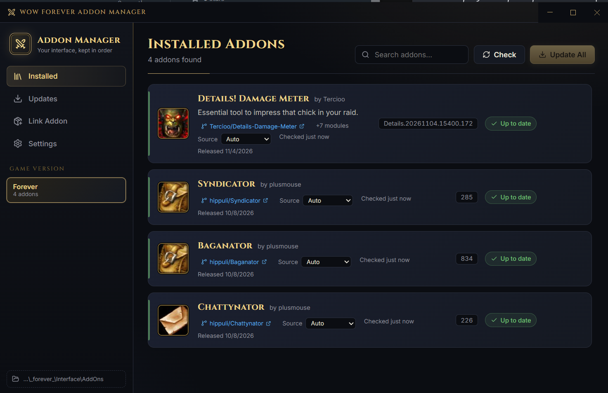

# WoW Forever Addon Manager

A desktop addon manager for **WoW Forever**. It finds the addons you already have installed, lets you
link them (or new ones) to their GitHub repositories, and keeps them up to date, by hand or automatically.



## Features

- **Auto-discovery.** Reads the `.toc` file of every folder in `_forever_\Interface\AddOns` for name,
  author, version and notes. Plugin folders are grouped under their parent addon (for example `DBM-GUI`
  under `DBM-Core`). Addons that advertise a GitHub page can be linked in one click.
- **Link from GitHub.** Paste `owner/repo` or any GitHub URL, including `/tree/<tag>` links. The addon is
  installed into your AddOns folder and tracked from then on.
- **Update by button or automatically.** Check, Update and Update All on demand, plus an optional
  background auto-update on a schedule (15 minutes to 6 hours). Checking always runs; installing only
  happens if auto-update is on.
- **Per-addon update source.** Choose where each addon's updates come from:
  - **Auto** (default): the latest GitHub release, unless a tag is more than ~3 months newer.
  - **Releases**: only GitHub releases.
  - **Tags**: the newest tag by date.
  - **Latest code**: the newest commit on the default branch.
- **Handles real-world repos.** Source installs honor `.pkgmeta` (`package-as` and `move-folders`), so
  bundled plugins such as Details!'s Streamer or RaidCheck land as their own addon folders. Release zips
  built for other clients (Classic, Era, and so on) are skipped.
- **Safe installs.** New files are staged and swapped in; your `WTF` folder and saved variables are never
  touched. Uninstall asks for confirmation. Unlink leaves files in place.

## Run it

Requires Node.js 22+ and npm.

```bash
npm install
npm run dev
```

Other scripts:

```bash
npm run typecheck   # tsc for main + renderer
npm run build       # typecheck + production build
npm run build:win   # Windows installer
```

## Setup

The WoW folder defaults to `C:\Program Files (x86)\World of Warcraft`. Change it in **Settings**
(there is a Browse button). Only the `_forever_` client folder is managed; other clients in the same
install are ignored.

Optional: add a GitHub personal access token in Settings to raise the API limit from 60 to 5,000
requests per hour. It is stored locally in the app's database.

## How it works

| Piece | Details |
| --- | --- |
| Shell | Electron, with React + TypeScript in the renderer (electron-vite) |
| Storage | SQLite via Node's built-in `node:sqlite`, in the app data folder (`addons.db`) holding links and settings |
| Discovery | `.toc` parsing and module grouping (`src/main/wow.ts`) |
| GitHub | Release/tag/commit lookup, asset selection, zip install, `.pkgmeta` (`src/main/github.ts`) |
| Logic | Link, check, update and schedule (`src/main/service.ts`) |

Tag lookups use GitHub's Atom feed (newest-first, no API quota); release and commit lookups use the REST API.

## Notes

- Addon icons come from Wowhead's icon CDN, or the repo owner's GitHub avatar as a fallback.
- Not affiliated with or endorsed by Blizzard Entertainment. World of Warcraft is a trademark of
  Blizzard Entertainment, Inc.
